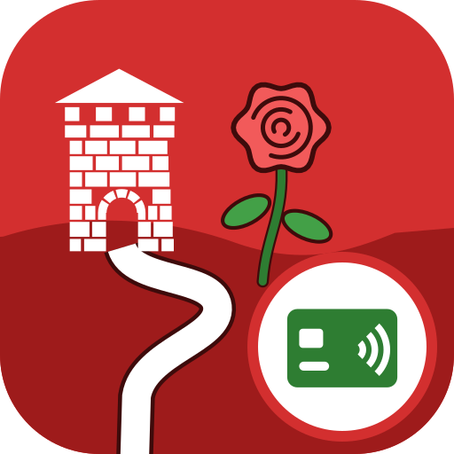

<h1 align="center">Rosenweg Karten</h1>

NFC-Zutrittskarten der Siedlung Rosenweg verwalten – für die Technik.

<a href="https://www.rosenweg4303.ch/apps">Herunterladen</a> · <a href="docs/anleitung.md">Anleitung</a> · <a href="docs/entwickeln.md">Für Entwickler</a>

## Was die App kann

- Karte hinten ans Telefon halten: Besitzer, Inventarnummer und Status.
- Karte einer Person zuordnen – über eine durchsuchbare Liste.
- Karte entziehen oder aus dem Bestand löschen, jeweils mit Rückfrage.
- Läuft auf den geteilten Rosenweg-Telefonen und auf dem eigenen Handy.
- Nur für Berechtigte; die Telefonanlage prüft jede Aktion.

## Plattformen

Android.

## Entwickeln

Android-App (Gradle) mit dem Modul `cloud` aus
[commons-rosenweg](https://github.com/Rosenweg/commons-rosenweg).
Bau, Signatur, neue Version und Logo stehen in [docs/entwickeln.md](docs/entwickeln.md).

## Lizenz

Eigene Entwicklung für die Siedlung Rosenweg. Eine Lizenz ist noch nicht festgelegt (keine LICENSE-Datei im Repo).
